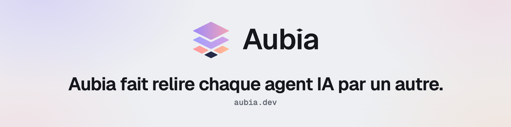

<picture>
  <source media="(prefers-color-scheme: dark)" srcset="assets/aubia-github-header-fr-dark.png">
  
</picture>

[English](README.md) | **Français**

[Rejoindre la liste d'attente →](https://aubia.dev) | [Journal de bord →](https://aubia.dev/fr/blog) | [Discussions communautaires →](https://github.com/aubia-dev/community/discussions) | [@aubia_dev](https://x.com/aubia_dev) | [LinkedIn](https://www.linkedin.com/company/aubia-dev)

Le moyen le plus simple de ne pas voir une erreur, c'est d'être celui qui l'a écrite, et c'est tout aussi vrai pour un agent IA. Aubia est la couche au-dessus de Claude Code, Codex CLI et Mistral qui croise leurs relectures : chaque sortie d'un agent est relue par le modèle d'un autre provider avant de vous parvenir.

## Cross-review et Mode Opinions vers Plan exécutable

Dans la cross-review automatique, un agent implémente et un modèle d'une autre famille relit. Les deux s'échangent le diff jusqu'à convergence, en 3 itérations par défaut, un paramètre que vous pouvez modifier. Si leur désaccord persiste, vous arbitrez.

Le Mode Opinions vers Plan exécutable soumet une décision technique à plusieurs modèles en parallèle. Chacun argumente sa position, puis Aubia synthétise les convergences, isole les désaccords et génère un Plan exécutable que vous approuvez ou ajustez.

## BYOK et agents en local

Vous gardez vos abonnements et vos clés Anthropic, OpenAI et Mistral, et Aubia ne revend pas de tokens. Vos clés API sont chiffrées dans le coffre sécurisé de votre OS. Les agents tournent sur votre machine, chacun dans son propre git worktree, et aucun serveur d'Aubia ne voit vos sources.

## Feuille de route

| Jalon | Contenu |
|---|---|
| Phase 0, en cours | Liste d'attente publique, ce profil, l'espace communautaire et le journal de bord sur aubia.dev |
| Bêta 0.1 | Sur macOS Apple Silicon : cross-review, Mode Opinions vers Plan exécutable et cockpit local. Premières invitations de la liste d'attente |
| Après la bêta 0.1 | Une fonctionnalité par version 0.x, dont deux nouveaux providers : Gemini via Antigravity CLI et un moteur local compatible avec l'API d'OpenAI. Le détail se trouve sur la [feuille de route d'aubia.dev](https://aubia.dev/fr#roadmap) |
| 1.0 | Prise en charge de Linux et de Windows |

## Contact

Pour la presse et les partenariats, écrivez à `contact@aubia.dev`. Pour vos données personnelles et le RGPD, à `dpo@aubia.dev`.

Aubia est conçu et écrit par Mike EL GHALI, depuis Paris. Le journal de bord raconte ses décisions, article après article.
